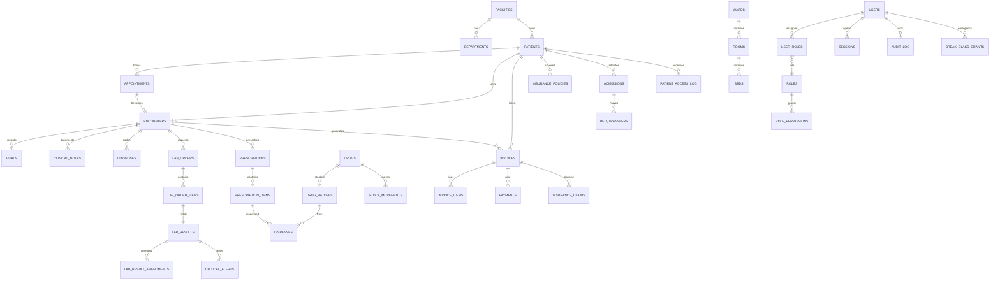

# نموذج البيانات وقاعدة البيانات

- **المحرك:** PostgreSQL 18 (التطوير عبر PGlite بنفس المحرك، والإنتاج عبر `pg`).
- **الترحيلات:** `db/migrations/*.sql` (001..008) تُطبَّق بترتيب اسمي، وتُسجَّل في `schema_migrations` مع checksum؛ تعديل ملف مطبَّق يوقف الترحيل (يمنع الانحراف).
- **الأدوار:** `hms_owner` (ترحيلات فقط) / `hms_app` (عمل الموظفين، RLS مفروض) / `hms_portal` (المريض، RLS بمستوى المريض).
- **الجلسة:** كل معاملة تُنفّذ `SET LOCAL ROLE` + `set_config('app.facility_ids'|'app.patient_id', …, true)` فلا تتسرب الصلاحيات بين الطلبات.

## العلاقات الأساسية

## الجداول (44)

| المجموعة | الجداول |
|---|---|
| المنشآت والهوية | `facilities`, `departments`, `users`, `user_facilities`, `roles`, `permissions`, `role_permissions`, `user_roles`, `sessions`, `user_recovery_codes` |
| التدقيق والبنية | `audit_log`, `audit_chain_state`, `idempotency_keys`, `number_sequences`, `app_settings`, `notifications_outbox`, `break_glass_grants`, `patient_access_log` |
| المرضى | `patients`, `patient_allergies`, `patient_conditions`, `consents` |
| العيادة | `appointments`, `encounters`, `vitals`, `clinical_notes`, `diagnoses` |
| المختبر | `lab_tests`, `lab_orders`, `lab_order_items`, `lab_results`, `lab_result_amendments`, `critical_alerts` |
| الصيدلية | `drugs`, `drug_batches`, `drug_interactions`, `prescriptions`, `prescription_items`, `dispenses`, `stock_movements` |
| الفوترة | `insurance_policies`, `invoices`, `invoice_items`, `payments`, `insurance_claims` |
| التنويم | `wards`, `rooms`, `beds`, `admissions`, `bed_transfers` |
| عرض للمريض | `portal_clinicians` (VIEW) |

## قيود سلامة مهمة

| القيد | الغرض |
|---|---|
| `patients (facility_id, mrn)` UNIQUE + `national_id_hash` UNIQUE (غير المدموج) | منع التكرار |
| `appointments_no_double_booking (doctor_id, scheduled_at) WHERE status IN ('booked','checked_in','in_consultation')` | منع الحجز المزدوج |
| `encounters_one_open_per_patient WHERE status='open' AND type<>'inpatient'` | زيارة مفتوحة واحدة |
| `invoice_items_reference_uq (reference_type, reference_id)` | منع تحصيل الخدمة مرتين |
| `admissions_one_active_per_bed` / `_per_patient` | منع سرير/تنويم مزدوج |
| `drug_batches.qty_on_hand >= 0` | منع مخزون سالب |
| `payments.amount > 0` + منع الدفع الزائد في الخدمة (`FOR UPDATE`) | سلامة الرصيد |
| `clinical_notes` / `lab_result_amendments` / `stock_movements` / `audit_log` append-only | عدم فقد التاريخ |
| `hash_version` على `audit_log` | تطور خوارزمية السلسلة دون إبطال صامت |

## معايير الترميز المستخدمة

- **ICD-10**: حقل `icd10_code` مع وصف حر (لا تحميل كامل لمفردات ICD-10-CM؛ التحقق من صحة الرمز غير منفذ).
- **LOINC**: `lab_tests.code` يحمل رموز LOINC (مجموعة تجريبية صغيرة: 718-7، 6690-2، 2345-7، 2160-0، 4548-4).
- **FHIR R4**: واجهة قراءة جزئية (Patient/Observation) وليست تنفيذًا معتمدًا.
- **SNOMED CT / DICOM**: غير مستخدمة/غير منفذة (تتطلب ترخيصًا/تكاملًا).
